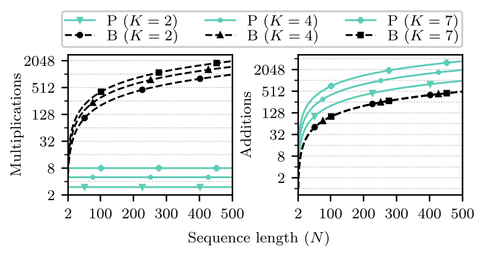

README.md

# Efficient Computation of Order–K Index-Powered Weighted Sums Using Cascaded Accumulators

This repository contains the code and Jupyter notebook accompanying the paper:

> **Efficient Computation of Order–K Index-Powered Weighted Sums Using Cascaded Accumulators**  
> Deijany Rodriguez Linares, Oksana Moryakova, and Håkan Johansson  
> IEEE Signal Processing Letters, doi: [10.1109/LSP.2026.3661843](https://doi.org/10.1109/LSP.2026.3661843).

## Overview

Given a sequence $$v[n]$$ and integers $$K, N \geq 0$$, the objective is to compute $$S_K(N) = \sum_{n=0}^{N-1} n^K v[n]$$ in real time on a sample-by-sample basis (avoiding sample buffering).

The proposed equivalence, based on cascaded accumulators, is presented in the paper above and in the accompanying notebook. The figure below compares its computational cost with that of [addition-chain exponentiation](https://en.wikipedia.org/wiki/Addition-chain_exponentiation) for $$K = 2, 4, 7$$ and $$N = 1, \dots, 500$$. The proposed method reduces the number of multiplications several-fold.



## Repository locations

- **Primary (GitLab):** https://gitlab.liu.se/spl/SPL-44561-2025  
- **Mirror (GitHub):** https://github.com/deijany/SPL-44561-2025
---

## Run the notebook in Colab

Click below to launch the notebook in Google Colab:

[](
https://colab.research.google.com/github/deijany/order_k_index_powered_weighted_sums_using_cascaded_accumulators/blob/main/accumulators_notebook.ipynb)
---

## Contents
- `accumulators_notebook.ipynb` — Notebook to generate the coefficients \(c_k\) used in the paper, and to compute the order–K index-powered weighted sums via cascaded accumulators.
---

## How to cite

If you use this code in your research, please cite our paper:

```bibtex
@ARTICLE{11372997,
  author={Linares, Deijany Rodriguez and Moryakova, Oksana and Johansson, Håkan},
  journal={IEEE Signal Processing Letters}, 
  title={Efficient Computation of Time-Index Powered Weighted Sums Using Cascaded Accumulators}, 
  year={2026},
  volume={33},
  number={},
  pages={893-897},
  keywords={Polynomials;Real-time systems;Costs;Computational efficiency;Transfer functions;Table lookup;Registers;Convolution;Artificial intelligence;Time-frequency analysis;Accumulators;addition-chain exponentiation;binomial coefficients;Stirling numbers;time-index powered weighted sums},
  doi={10.1109/LSP.2026.3661843}}


